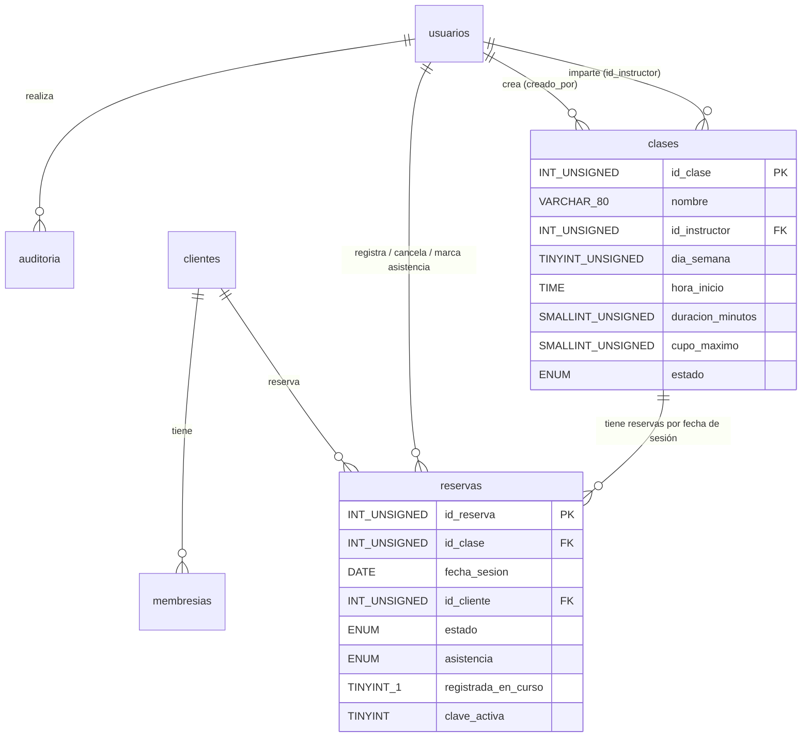

# Reporte individual — SDD con Spec Kit

## Datos de la entrega

| Dato | Valor |
|------|-------|
| Alumna | Itzel Lazcano Vergara |
| Equipo y proyecto | GymAccess — Sistema de Gestión para Gimnasio |
| Repositorio | https://github.com/ItzeLaz/gymacces |
| Rama | [`004-reservas-clases`](https://github.com/ItzeLaz/gymacces/tree/004-reservas-clases) |
| Funcionalidad | Reservas de clases grupales (`specs/004-reservas-clases/`) |
| Agente | Claude Code con GitHub Spec Kit (integración `claude`) |

---

## 0. Índice de evidencias

| Apartado del reporte | Archivo y hash del commit |
|----------------------|---------------------------|
| 1. Constitución v2.1.0 | [`.specify/memory/constitution.md`](https://github.com/ItzeLaz/gymacces/blob/004-reservas-clases/.specify/memory/constitution.md) — [`5482e33`](https://github.com/ItzeLaz/gymacces/commit/5482e3327390c41087a52636b2c9bfbab3200da6) |
| 1. EARS en AGENTS.md y plantilla | [`AGENTS.md`](https://github.com/ItzeLaz/gymacces/blob/004-reservas-clases/AGENTS.md), [`spec-template.md`](https://github.com/ItzeLaz/gymacces/blob/004-reservas-clases/.specify/templates/spec-template.md) — [`6659a5c`](https://github.com/ItzeLaz/gymacces/commit/6659a5cd24dd239bd3cf1fc531d200fcef0cadea) |
| 2. Spec | [`spec.md`](https://github.com/ItzeLaz/gymacces/blob/004-reservas-clases/specs/004-reservas-clases/spec.md) — [`7f7b6e6`](https://github.com/ItzeLaz/gymacces/commit/7f7b6e6859cf8f53c675d2ca0a75f43a876c0e3f), [`4ac8768`](https://github.com/ItzeLaz/gymacces/commit/4ac87686072cabae2a4c30a2280a49741157ede5), [`2a031d0`](https://github.com/ItzeLaz/gymacces/commit/2a031d0cde6b2bc7505881a0d78572c16c5e0552), [`f02a83d`](https://github.com/ItzeLaz/gymacces/commit/f02a83d44dbd32ee151ab99e9bfc62263aa420db) |
| 3. Plan, research y contrato | [`plan.md`](https://github.com/ItzeLaz/gymacces/blob/004-reservas-clases/specs/004-reservas-clases/plan.md), [`research.md`](https://github.com/ItzeLaz/gymacces/blob/004-reservas-clases/specs/004-reservas-clases/research.md), [`contracts/api.md`](https://github.com/ItzeLaz/gymacces/blob/004-reservas-clases/specs/004-reservas-clases/contracts/api.md) — [`b75331e`](https://github.com/ItzeLaz/gymacces/commit/b75331e9ac8d7df22bd53506debf12d55d54db24) |
| 4. Modelo de datos y migración 006 | [`data-model.md`](https://github.com/ItzeLaz/gymacces/blob/004-reservas-clases/specs/004-reservas-clases/data-model.md) — [`b75331e`](https://github.com/ItzeLaz/gymacces/commit/b75331e9ac8d7df22bd53506debf12d55d54db24); [`006_create_clases_reservas.sql`](https://github.com/ItzeLaz/gymacces/blob/004-reservas-clases/database/migrations/006_create_clases_reservas.sql) — [`79f130b`](https://github.com/ItzeLaz/gymacces/commit/79f130b7245dbe634ab014211bb9f8e30fd5bc5a) |
| 5. Tareas y análisis | [`tasks.md`](https://github.com/ItzeLaz/gymacces/blob/004-reservas-clases/specs/004-reservas-clases/tasks.md) — [`d5f1bea`](https://github.com/ItzeLaz/gymacces/commit/d5f1bea9b16cb25146a1bdfd35e9e719c8c104d7), [`283a48d`](https://github.com/ItzeLaz/gymacces/commit/283a48d739da7ee50e50700d2a43278940d192f2), [`20be41a`](https://github.com/ItzeLaz/gymacces/commit/20be41aa87afd7ed612e2cd4aa54e960545f70ed) |
| 6. Implementación por fases | [`evidencias/`](https://github.com/ItzeLaz/gymacces/tree/004-reservas-clases/specs/004-reservas-clases/evidencias) — de [`79f130b`](https://github.com/ItzeLaz/gymacces/commit/79f130b7245dbe634ab014211bb9f8e30fd5bc5a) a [`9823b60`](https://github.com/ItzeLaz/gymacces/commit/9823b607fe867145117b45df4264cb2f15733e3d) |
| 6. Prueba manual T104 y capturas | [`quickstart.md`](https://github.com/ItzeLaz/gymacces/blob/004-reservas-clases/specs/004-reservas-clases/quickstart.md) (sección 6), [`evidencias/capturas/`](https://github.com/ItzeLaz/gymacces/tree/004-reservas-clases/specs/004-reservas-clases/evidencias/capturas) — [`93d099a`](https://github.com/ItzeLaz/gymacces/commit/93d099abff81a7a71dec32e475d1b883ae2e1ecd), [`6f0b1bd`](https://github.com/ItzeLaz/gymacces/commit/6f0b1bd6a3e1f11a856541c6a1b6b9307cceac10) |
| 6. Corrección del menú | [`Layout.jsx`](https://github.com/ItzeLaz/gymacces/blob/004-reservas-clases/frontend/src/components/Layout.jsx), [`global.css`](https://github.com/ItzeLaz/gymacces/blob/004-reservas-clases/frontend/src/styles/global.css) — [`ebd1591`](https://github.com/ItzeLaz/gymacces/commit/ebd15913a8608e5317ead9eae4615194ca1f2895) |
| 7. EARS y reflexión | Este archivo (`REPORTE.md`, apartado 7); bono: [`6659a5c`](https://github.com/ItzeLaz/gymacces/commit/6659a5cd24dd239bd3cf1fc531d200fcef0cadea), [`7f7b6e6`](https://github.com/ItzeLaz/gymacces/commit/7f7b6e6859cf8f53c675d2ca0a75f43a876c0e3f), [`f02a83d`](https://github.com/ItzeLaz/gymacces/commit/f02a83d44dbd32ee151ab99e9bfc62263aa420db) |

---

## 1. Contexto y constitution

### Problema y funcionalidad

**GymAccess** es un sistema web para administrar un gimnasio. Maneja clientes, membresías, pagos y
el acceso por reconocimiento facial, con permisos según el rol de cada usuario (fuente:
introducción de la [constitución](https://github.com/ItzeLaz/gymacces/blob/004-reservas-clases/.specify/memory/constitution.md)).

La funcionalidad de este reporte, **reservas de clases grupales**, resuelve el problema de las
clases con cupo limitado (spinning, yoga, funcional): hoy no hay forma de controlar quién asiste
ni de evitar el sobrecupo ([`spec.md`](https://github.com/ItzeLaz/gymacces/blob/004-reservas-clases/specs/004-reservas-clases/spec.md), "Entrada").

**Para quién**:

- **Administrador**: registra el horario semanal de clases y consulta la ocupación.
- **Recepción** (rol recepcionista): reserva, cancela y marca la asistencia.
- El entrenador y el cliente no tienen acceso a este módulo.

Es una **ampliación posterior al MVP**: el MVP de la constitución (principio VIII) quedó completo
con los Sprints 1 a 3. La justificación está en la sección "Justificación de alcance" del spec.

### Principios I a VII

Constitución v2.1.0 (2026-10-16), commit
[`5482e33`](https://github.com/ItzeLaz/gymacces/commit/5482e3327390c41087a52636b2c9bfbab3200da6).

| # | Principio | Razón (texto de la constitución) |
|---|-----------|-----------------------------------|
| I | Stack tecnológico fijo: Node.js + Express (ES Modules), MySQL, React + Vite; ningún framework nuevo sin justificarlo en el plan | Un stack fijo y conocido por todo el equipo evita que cada feature introduzca herramientas distintas, reduce la curva de aprendizaje y mantiene el proyecto fácil de instalar, probar y mantener. |
| II | Pruebas obligatorias: toda regla de negocio del backend tiene prueba automática; `npm test` pasa antes de cada commit de implementación | Las reglas de negocio (vigencia de membresías, pagos, acceso) son el núcleo del sistema; una prueba automática que se ejecuta antes de cada commit detecta regresiones cuando todavía son baratas de corregir. |
| III | Seguridad: bcrypt, validación en el backend, SQL parametrizado, sin secretos ni `.env` en el repositorio, acceso por rol | El sistema maneja información personal, financiera y biométrica de los clientes; una sola contraseña filtrada, una inyección SQL o una ruta sin control de rol comprometería a todo el gimnasio. |
| IV | Manejo de datos: UTF-8 (`utf8mb4`) y cada cambio de base de datos en una migración SQL versionada en `database/` | El sistema registra nombres en español con tildes y eñes que se corrompen fuera de `utf8mb4`, y las migraciones versionadas garantizan que todo el equipo tenga exactamente la misma estructura de base de datos. |
| V | Estilo de código: mensajes en español, identificadores en inglés y código consistente con el existente | Los usuarios del gimnasio hablan español, mientras que los identificadores en inglés y un estilo uniforme hacen que cualquier integrante del equipo pueda leer y modificar cualquier módulo. |
| VI | Requisitos en EARS: criterios de aceptación con los patrones Ubicuo, Cuando, Mientras, Si... entonces y Donde | Los patrones EARS eliminan la ambigüedad de los requisitos en lenguaje natural y producen criterios que se traducen directamente en pruebas automáticas. |
| VII | Trazabilidad: un commit por paso de Spec Kit y por grupo de tareas con sus IDs; sin squash ni force-push | Un historial completo que enlaza cada commit con su paso de Spec Kit o sus tareas permite reconstruir por qué y cuándo se hizo cada cambio, y evaluar el proceso del proyecto. |

Para que el principio VI se aplicara en todos los specs nuevos, `AGENTS.md` y la plantilla de spec
se cambiaron de "Dado / Cuando / Entonces" a EARS en el commit
[`6659a5c`](https://github.com/ItzeLaz/gymacces/commit/6659a5cd24dd239bd3cf1fc531d200fcef0cadea).

---

## 2. Spec

Archivo: [`specs/004-reservas-clases/spec.md`](https://github.com/ItzeLaz/gymacces/blob/004-reservas-clases/specs/004-reservas-clases/spec.md)
(estado: Implementada, 2026-10-16).

### Historias de usuario

| Historia | Prioridad | Criterios EARS |
|----------|-----------|----------------|
| US1 — Como administrador, quiero registrar clases (nombre, instructor, día y hora, duración y cupo máximo) para publicar el horario semanal. | P1 | 14 |
| US2 — Como recepción, quiero reservar un lugar a un cliente en una clase para asegurar su asistencia. | P1 | 10 |
| US3 — Como recepción, quiero cancelar la reserva de un cliente para liberar el lugar. | P2 | 4 |
| US4 — Como administrador, quiero ver la lista de reservados de cada clase y cuántos lugares quedan. | P2 | 6 |
| US5 — Como recepción, quiero marcar asistencia de los reservados al iniciar la clase. | P3 | 6 |
| **Total** | | **40** |

Además: 14 requisitos funcionales (FR-001 a FR-014) y 6 criterios de éxito (SC-001 a SC-006).

### Casos límite (9)

1. Clase llena.
2. Membresía vencida o inexistente.
3. Reserva duplicada.
4. Clases que se empalman.
5. Cancelar una reserva de una clase que ya empezó.
6. Cliente que llega sin reserva a una clase en curso.
7. Reducir el cupo por debajo de las reservas.
8. Cambiar el horario o desactivar una clase con reservas futuras.
9. Membresía que cambia después de reservar.

### Ambigüedades resueltas (sección "Clarifications", sesión 2026-10-16)

| Pregunta | Respuesta | Commit |
|----------|-----------|--------|
| Q1. ¿Las clases se registran como un horario semanal que se repite o como sesiones sueltas con fecha y hora únicas? | Como clase semanal que se repite; cada fecha es una sesión que se reserva por separado, con hasta 7 días de anticipación. | [`4ac8768`](https://github.com/ItzeLaz/gymacces/commit/4ac87686072cabae2a4c30a2280a49741157ede5) |
| ¿El instructor debe ser un usuario registrado con rol entrenador o basta con escribir su nombre? | Un usuario registrado, activo y con rol entrenador, que se elige de una lista. | [`2a031d0`](https://github.com/ItzeLaz/gymacces/commit/2a031d0cde6b2bc7505881a0d78572c16c5e0552) |
| Si un cliente sin reserva llega cuando la clase ya empezó y hay lugares, ¿recepción puede registrarlo? | Sí, mientras la sesión está en curso y hay lugares; la reserva se crea con la asistencia ya marcada como presente. | [`2a031d0`](https://github.com/ItzeLaz/gymacces/commit/2a031d0cde6b2bc7505881a0d78572c16c5e0552) |

### Cómo cambió el spec

| Commit | Cambio |
|--------|--------|
| [`7f7b6e6`](https://github.com/ItzeLaz/gymacces/commit/7f7b6e6859cf8f53c675d2ca0a75f43a876c0e3f) | `/speckit-specify`: 5 historias con criterios EARS, casos límite y un marcador `[NEEDS CLARIFICATION]` (Q1). |
| [`4ac8768`](https://github.com/ItzeLaz/gymacces/commit/4ac87686072cabae2a4c30a2280a49741157ede5) | Se resolvió Q1 y se agregó la sección "Justificación de alcance" (ampliación posterior al MVP). |
| [`2a031d0`](https://github.com/ItzeLaz/gymacces/commit/2a031d0cde6b2bc7505881a0d78572c16c5e0552) | `/speckit-clarify`: instructor como entrenador activo y reserva durante la clase con asistencia marcada; los criterios de US1 y US2 se renumeraron. |
| [`f02a83d`](https://github.com/ItzeLaz/gymacces/commit/f02a83d44dbd32ee151ab99e9bfc62263aa420db) | Criterio US1-14 (la clase termina el mismo día), que salió de la decisión R-06 del plan. |
| [`283a48d`](https://github.com/ItzeLaz/gymacces/commit/283a48d739da7ee50e50700d2a43278940d192f2) | Correcciones de `/speckit-analyze`: término "Sesión futura", mensaje "La clase está inactiva", punto final en FR-013 y supuesto del entrenador desactivado. |
| [`6f0b1bd`](https://github.com/ItzeLaz/gymacces/commit/6f0b1bd6a3e1f11a856541c6a1b6b9307cceac10) | Estado del spec: "Implementada". |

---

## 3. Plan técnico

Archivos: [`plan.md`](https://github.com/ItzeLaz/gymacces/blob/004-reservas-clases/specs/004-reservas-clases/plan.md),
[`research.md`](https://github.com/ItzeLaz/gymacces/blob/004-reservas-clases/specs/004-reservas-clases/research.md)
y [`contracts/api.md`](https://github.com/ItzeLaz/gymacces/blob/004-reservas-clases/specs/004-reservas-clases/contracts/api.md);
commit [`b75331e`](https://github.com/ItzeLaz/gymacces/commit/b75331e9ac8d7df22bd53506debf12d55d54db24).

### Arquitectura, stack y estructura

- **Stack** (principio I, sin dependencias nuevas):
  - Backend: Node.js con Express 5 y ES Modules, `express-validator` y `mysql2`.
  - Base de datos: MySQL 8 o MariaDB 10.4+ con InnoDB y `utf8mb4_unicode_ci`.
  - Frontend: React 19 con Vite y React Router.
  - Pruebas: `node:test` + `supertest` en el backend; Vitest + Testing Library en el frontend.
- **Arquitectura**: las mismas capas de los sprints anteriores (ruta → validador → controlador →
  servicio → modelo). La lógica de negocio vive en `classes.service.js` y
  `reservations.service.js`, y las funciones puras de sesiones en `utils/sessions.js`.
- **API REST**: dos routers.
  - `/classes`: catálogo, instructores, horario y detalle de sesión.
  - `/reservations`: reservar, cancelar y asistencia.
- **Estructura**: se mantienen `backend/`, `frontend/` y `database/`; no se crean carpetas nuevas en
  la raíz. Frontend: páginas `Classes`, `ClassForm`, `Schedule` y `SessionDetail`, y el componente
  `ReservationForm`.

### Decisiones técnicas (R-01 a R-10)

| ID | Decisión | Alternativa descartada | Motivo del descarte |
|----|----------|------------------------|---------------------|
| R-01 | Las sesiones se calculan al vuelo con `(id_clase, fecha_sesion)`, sin tabla propia | Tabla `sesiones_clase` generada por un proceso programado | Agrega un proceso que debe correr cada semana y duplica datos de `clases`; solo haría falta para cancelar sesiones sueltas, que quedó fuera de alcance |
| R-02 | Transacción con bloqueo `FOR UPDATE` (cliente → clase) más un índice único para duplicados | Contador `ocupados` por sesión, SERIALIZABLE, bloqueo optimista o solo restricción única | El contador necesita tabla de sesiones; SERIALIZABLE provoca interbloqueos; el optimista agrega reintentos; la restricción única no puede limitar el cupo |
| R-03 | Empalmes validados en el servicio del backend, dentro de la transacción | Disparadores en la base o validar solo en el frontend | Los disparadores no se usan en el proyecto, sus mensajes son difíciles de traducir y su sintaxis difiere entre MySQL y MariaDB; el frontend no es una medida de seguridad |
| R-04 | Routers `/classes` y `/reservations`, con acciones como `PATCH /:id/<acción>` | Rutas totalmente anidadas o bajo `/clients/:id/reservations` | Rutas largas con tres parámetros sin beneficio; el flujo parte de la sesión y no del cliente |
| R-05 | La hora actual se calcula en Node con `APP_TIMEZONE` (`nowInGym()`); ninguna consulta usa `NOW()` | `NOW()` en SQL o guardar sesiones en UTC | Depende de la zona de MySQL/XAMPP y no se puede simular en las pruebas; no hay tabla de sesiones |
| R-06 | La clase debe terminar el mismo día (CHECK en la base y validación en el backend) | Permitir clases que crucen la medianoche | Obligaría a comparar intervalos entre dos fechas y a redefinir "el mismo día" de la asistencia |
| R-07 | Se reutiliza la vigencia de membresías del Sprint 2, evaluada en la fecha de la sesión | Escribir una consulta nueva de vigencia | Duplicaría la regla y podría divergir del control de acceso |
| R-08 | 422 para reglas de negocio, 409 para duplicados, 403 y 400 existentes; mensajes con punto final | Usar 409 para todos los rechazos | Mezclaría conflictos de unicidad con reglas de negocio, en contra del contrato del Sprint 2 |
| R-09 | Sin dependencias nuevas | Una librería de calendario (por ejemplo, FullCalendar) | Agrega peso y estilos propios para una vista de 8 días que se resuelve con una tabla |
| R-10 | Pruebas unitarias, de integración por criterio EARS, de concurrencia (20 solicitudes) y del frontend | Pruebas de extremo a extremo con navegador (Playwright o Cypress) | Serían un framework nuevo sin justificación (principio I); el recorrido se valida a mano con `quickstart.md` |

### Verificación de la constitución

- **Principios I a VII y IX a XIV**: cumplidos.
- **Principio VIII (alcance del MVP)**: desviación justificada.
  - **Qué se desvía**: el MVP y `docs/` no incluían clases grupales.
  - **Por qué se justifica**: el MVP quedó completo en los Sprints 1 a 3; la feature resuelve el
    sobrecupo, refuerza la regla de membresía vigente (principio XI) y da datos de ocupación.
  - **Qué queda fuera**: reservas del propio cliente, listas de espera, notificaciones, cancelar
    una sesión suelta, sanciones, consultas del entrenador, cobro por clase y reportes de
    ocupación.
  - **Aprobación**: la decisión la tomó la autora para su reporte individual; la aprobación formal
    del equipo queda pendiente (T004).
- **Resultado de la compuerta**: "aprobada con condición: aprobación del equipo pendiente,
  registrada en T004".

---

## 4. Base de datos

Archivos: [`data-model.md`](https://github.com/ItzeLaz/gymacces/blob/004-reservas-clases/specs/004-reservas-clases/data-model.md)
y la migración [`database/migrations/006_create_clases_reservas.sql`](https://github.com/ItzeLaz/gymacces/blob/004-reservas-clases/database/migrations/006_create_clases_reservas.sql),
creada en el commit [`79f130b`](https://github.com/ItzeLaz/gymacces/commit/79f130b7245dbe634ab014211bb9f8e30fd5bc5a).

La migración no modifica las migraciones 001 a 005 (principio IV). Se aplicó en la base de pruebas
y en la de desarrollo (`gym_access`) con `db:migrate` (T103).

### Tabla `clases`

| Campo | Tipo | Restricciones |
|-------|------|---------------|
| `id_clase` | `INT UNSIGNED` | PK, `AUTO_INCREMENT` |
| `nombre` | `VARCHAR(80)` | `NOT NULL`, `CHECK (CHAR_LENGTH(TRIM(nombre)) > 0)` |
| `id_instructor` | `INT UNSIGNED` | `NOT NULL`, FK → `usuarios(id_usuario)` |
| `dia_semana` | `TINYINT UNSIGNED` | `NOT NULL`, `CHECK (dia_semana BETWEEN 1 AND 7)` (1 = lunes) |
| `hora_inicio` | `TIME` | `NOT NULL`, `CHECK (hora_inicio >= '00:00:00' AND hora_inicio < '24:00:00')` |
| `duracion_minutos` | `SMALLINT UNSIGNED` | `NOT NULL`, `CHECK (duracion_minutos BETWEEN 15 AND 240)` |
| `cupo_maximo` | `SMALLINT UNSIGNED` | `NOT NULL`, `CHECK (cupo_maximo BETWEEN 1 AND 100)` |
| `estado` | `ENUM('activa', 'inactiva')` | `NOT NULL DEFAULT 'activa'` |
| `creado_por` | `INT UNSIGNED` | `NOT NULL`, FK → `usuarios(id_usuario)` |
| `creado_en`, `actualizado_en` | `DATETIME` | `DEFAULT CURRENT_TIMESTAMP` (`actualizado_en` con `ON UPDATE`) |

- Restricción adicional: `chk_clases_mismo_dia CHECK (TIME_TO_SEC(hora_inicio) + duracion_minutos * 60 <= 86400)`.
- Índices: `idx_clases_dia_estado (dia_semana, estado, hora_inicio)`,
  `idx_clases_instructor_dia (id_instructor, dia_semana, estado)` e
  `idx_clases_creado_por (creado_por)`.

### Tabla `reservas`

| Campo | Tipo | Restricciones |
|-------|------|---------------|
| `id_reserva` | `INT UNSIGNED` | PK, `AUTO_INCREMENT` |
| `id_clase` | `INT UNSIGNED` | `NOT NULL`, FK → `clases(id_clase)` |
| `fecha_sesion` | `DATE` | `NOT NULL` |
| `id_cliente` | `INT UNSIGNED` | `NOT NULL`, FK → `clientes(id_cliente)` |
| `estado` | `ENUM('activa', 'cancelada')` | `NOT NULL DEFAULT 'activa'` |
| `asistencia` | `ENUM('sin_registrar', 'presente')` | `NOT NULL DEFAULT 'sin_registrar'` |
| `registrada_en_curso` | `TINYINT(1)` | `NOT NULL DEFAULT 0`, `CHECK (registrada_en_curso IN (0, 1))` |
| `clave_activa` | `TINYINT UNSIGNED` | Generada: `IF(estado = 'activa', 1, NULL) STORED` |
| `registrado_por` | `INT UNSIGNED` | `NOT NULL`, FK → `usuarios(id_usuario)` |
| `creado_en` | `DATETIME` | `NOT NULL DEFAULT CURRENT_TIMESTAMP` (el servicio la envía desde Node) |
| `cancelado_por`, `asistencia_por` | `INT UNSIGNED` | Nulas, FK → `usuarios(id_usuario)` |
| `cancelado_en`, `asistencia_en` | `DATETIME` | Nulas |

- Restricciones CHECK:
  - `chk_reservas_cancelacion`: si la reserva está cancelada, tiene `cancelado_por` y
    `cancelado_en`; si está activa, no.
  - `chk_reservas_asistencia`: si la asistencia es "presente", tiene `asistencia_por` y
    `asistencia_en`; si no, no.
  - `chk_reservas_cancelada_sin_asistencia`: una reserva cancelada no puede tener asistencia.
- Índices: `UNIQUE uq_reservas_sesion_cliente_activa (id_clase, fecha_sesion, id_cliente, clave_activa)`,
  `idx_reservas_cliente_fecha (id_cliente, fecha_sesion, estado)` e
  `idx_reservas_clase_fecha_estado (id_clase, fecha_sesion, estado)`.

### Diagrama entidad-relación

### Entidad → requisito

| Elemento | Requisitos |
|----------|------------|
| `clases` (campos y CHECK) y validación del instructor | FR-001 |
| `clases.dia_semana` y `hora_inicio`; sesión calculada; `reservas.fecha_sesion` | FR-002 |
| `reservas.id_cliente` y validación de cliente y membresía | FR-003 |
| Bloqueo `FOR UPDATE` de la clase + conteo; `cupo_maximo` | FR-004 |
| `uq_reservas_sesion_cliente_activa` e `idx_reservas_cliente_fecha` | FR-005 |
| Ventana `[hoy, hoy + 7]`, estado de la sesión y `registrada_en_curso` | FR-006 |
| `reservas.estado`, `cancelado_por` y `cancelado_en` | FR-007 |
| Conteo por `(id_clase, fecha_sesion)` y `lugares_disponibles` | FR-008 |
| `reservas.asistencia`, `asistencia_por` y `asistencia_en` | FR-009 |
| `idx_reservas_clase_fecha_estado` para reservas futuras | FR-010 |
| Middleware `authorize` | FR-011 |
| `auditoria` con las acciones `clase.*` y `reserva.*` | FR-012 |
| Mensajes del contrato | FR-013 |
| `nowInGym()` con `APP_TIMEZONE` | FR-014 |

---

## 5. Tareas

Archivo: [`tasks.md`](https://github.com/ItzeLaz/gymacces/blob/004-reservas-clases/specs/004-reservas-clases/tasks.md),
generado en [`d5f1bea`](https://github.com/ItzeLaz/gymacces/commit/d5f1bea9b16cb25146a1bdfd35e9e719c8c104d7).
Tiene **108 tareas** (T001–T108), todas en `[X]`.

| Fase | Contenido | Tareas |
|------|-----------|--------|
| 1 | Configuración inicial y documentación del alcance | T001–T004 (4) |
| 2 | Fundamentos: migración 006, utilidades, auditoría, fábricas y routers | T005–T016 (12) |
| 3 | US1: registrar clases | T017–T041, T106, T108 (27) |
| 4 | US2: reservar | T042–T059, T107 (19) |
| 5 | US4: horario y reservados | T060–T077 (18) |
| 6 | US3: cancelar | T078–T087 (10) |
| 7 | US5: asistencia | T088–T099 (12) |
| 8 | Pulido y verificación | T100–T105 (6) |

**Dependencias**:

- La Fase 2 bloquea a todas las historias.
- US4 va antes que US3 porque crea la pantalla de la sesión, donde viven la cancelación y la
  asistencia.
- Dentro de cada historia: pruebas → validadores y modelos → servicios → controladores y rutas →
  frontend.
- T004 (aprobación del equipo) no bloquea la implementación.

### `/speckit-analyze`

| Pasada | Hallazgos | Commit de las correcciones |
|--------|-----------|----------------------------|
| 1 | 11 hallazgos: C1 (crítico: la compuerta decía "aprobada" con la aprobación del equipo pendiente), G1 (alto: faltaba la prueba de auditoría de clases) y nueve medios o bajos: U1, U2, U3, G2, G3, I1, I2, I3 y A1 | [`283a48d`](https://github.com/ItzeLaz/gymacces/commit/283a48d739da7ee50e50700d2a43278940d192f2) (agregó las tareas T106, T107 y T108) |
| 2 | 3 hallazgos bajos: I4 (instructor activo solo al cambiarlo), I5 (`creado_en` desde Node) e I6 (nota del checklist) | [`20be41a`](https://github.com/ItzeLaz/gymacces/commit/20be41aa87afd7ed612e2cd4aa54e960545f70ed) |
| 3 | PENDIENTE: no se ejecutó una tercera pasada para confirmar 0 hallazgos | — |

---

## 6. Implementación y verificación

### Por fase

| Fase | Tareas | Commit | Backend | Frontend | Evidencia |
|------|--------|--------|---------|----------|-----------|
| 1 y 2 | T001–T016 | [`79f130b`](https://github.com/ItzeLaz/gymacces/commit/79f130b7245dbe634ab014211bb9f8e30fd5bc5a) | 192/192 | 44/44 | [`fase-1-2.txt`](https://github.com/ItzeLaz/gymacces/blob/004-reservas-clases/specs/004-reservas-clases/evidencias/fase-1-2.txt) |
| 3 (US1) | T017–T041, T106, T108 | [`fc54bda`](https://github.com/ItzeLaz/gymacces/commit/fc54bdab315d940bde02275fb5efb30054cd1b29) | 211/211 | 52/52 | [`fase-3-us1.txt`](https://github.com/ItzeLaz/gymacces/blob/004-reservas-clases/specs/004-reservas-clases/evidencias/fase-3-us1.txt) |
| 4 (US2) | T042–T059, T107 | [`60f6799`](https://github.com/ItzeLaz/gymacces/commit/60f67998107a0a4a16efdbec79d69966175ca402) | 225/225 | 56/56 | [`fase-4-us2.txt`](https://github.com/ItzeLaz/gymacces/blob/004-reservas-clases/specs/004-reservas-clases/evidencias/fase-4-us2.txt) |
| 5 (US4) | T060–T077 | [`1ca5ee1`](https://github.com/ItzeLaz/gymacces/commit/1ca5ee112c460c8bb41a29c1665e435067fbaf17) | 233/233 | 66/66 | [`fase-5-us4.txt`](https://github.com/ItzeLaz/gymacces/blob/004-reservas-clases/specs/004-reservas-clases/evidencias/fase-5-us4.txt) |
| 6 (US3) | T078–T087 | [`b2cf62f`](https://github.com/ItzeLaz/gymacces/commit/b2cf62f53a437e963c100aba8e5522a26c527b3d) | 238/238 | 69/69 | [`fase-6-us3.txt`](https://github.com/ItzeLaz/gymacces/blob/004-reservas-clases/specs/004-reservas-clases/evidencias/fase-6-us3.txt) |
| 7 (US5) | T088–T099 | [`5efc699`](https://github.com/ItzeLaz/gymacces/commit/5efc69929629a25530ae3c1a72bb2b5dd7928a12) | 245/245 | 73/73 | [`fase-7-us5.txt`](https://github.com/ItzeLaz/gymacces/blob/004-reservas-clases/specs/004-reservas-clases/evidencias/fase-7-us5.txt) |
| 8 | T100–T103 | [`9823b60`](https://github.com/ItzeLaz/gymacces/commit/9823b607fe867145117b45df4264cb2f15733e3d) | 246/246 | 73/73 | [`fase-8-verificacion.txt`](https://github.com/ItzeLaz/gymacces/blob/004-reservas-clases/specs/004-reservas-clases/evidencias/fase-8-verificacion.txt) |
| Hallazgo de T104 | Corrección del menú | [`ebd1591`](https://github.com/ItzeLaz/gymacces/commit/ebd15913a8608e5317ead9eae4615194ca1f2895) | Sin cambios | 75/75 | PENDIENTE (no hay archivo de evidencia de esta ejecución) |
| 8 | T104–T105 | [`6f0b1bd`](https://github.com/ItzeLaz/gymacces/commit/6f0b1bd6a3e1f11a856541c6a1b6b9307cceac10) | — | — | [`quickstart.md`](https://github.com/ItzeLaz/gymacces/blob/004-reservas-clases/specs/004-reservas-clases/quickstart.md) (sección 6) y [`capturas/`](https://github.com/ItzeLaz/gymacces/tree/004-reservas-clases/specs/004-reservas-clases/evidencias/capturas) |

Cambios al contrato durante la implementación:
[`b8f0e89`](https://github.com/ItzeLaz/gymacces/commit/b8f0e896907ed67841e9777cc6d7360d2dcbffe4)
(`details` como arreglo `[{ field, message }]`) y
[`0e19968`](https://github.com/ItzeLaz/gymacces/commit/0e199683eed56ff72b700bc7df9035aa54db78ef)
(mensajes del horario y del detalle de sesión).

### Criterios verificados

Pruebas del backend en `backend/tests/`; pruebas del frontend en `frontend/src/tests/`. Las capturas
están en `evidencias/capturas/`.

| Criterio | Prueba automática | Captura |
|----------|-------------------|---------|
| US1-1 | `classes.test.js` → `registra_clase_valida_como_activa_con_mensaje_clase_registrada`; `ClassForm.test.jsx` → `envia_la_clase_y_muestra_clase_registrada` | 01 |
| US1-2 | `rechaza_clase_sin_datos_obligatorios_indicando_el_campo` | — |
| US1-3 | `rechaza_duracion_fuera_de_15_a_240_minutos` | — |
| US1-4 | `rechaza_cupo_fuera_de_1_a_100_lugares` | — |
| US1-5 | `rechaza_clase_si_el_instructor_tiene_otra_que_se_empalma` | — |
| US1-6 | `rechaza_instructor_inexistente_inactivo_o_sin_rol_entrenador` | — |
| US1-7 | `lista_de_instructores_solo_incluye_entrenadores_activos` | — |
| US1-8 | `modificar_nombre_instructor_o_aumentar_cupo_se_aplica_a_sesiones_futuras` | — |
| US1-9 | `rechaza_reducir_cupo_por_debajo_de_las_reservas_existentes` | — |
| US1-10 | `rechaza_cambiar_horario_de_clase_con_reservas_activas` | — |
| US1-11 | `rechaza_desactivar_clase_con_reservas_activas` | — |
| US1-12 | `clase_desactivada_no_aparece_para_recepcion`, `el_horario_muestra_las_sesiones_de_la_ventana_con_sus_lugares` y `rechaza_reserva_de_cliente_inexistente_o_inactivo_y_en_clase_inactiva` | — |
| US1-13 | `classes-permissions.test.js` → `solo_el_administrador_registra_modifica_o_desactiva_clases` | — |
| US1-14 | `rechaza_clase_que_termina_despues_de_la_medianoche` | 02 |
| US2-1 | `reservations.test.js` → `reserva_lugar_para_cliente_con_membresia_activa_y_reduce_los_lugares` | 05 |
| US2-2 | `rechaza_reserva_en_clase_llena` | 06b |
| US2-3 | `rechaza_reserva_si_la_membresia_no_cubre_la_fecha_de_la_sesion` | 07 |
| US2-4 | `rechaza_reserva_de_cliente_inexistente_o_inactivo_y_en_clase_inactiva` | — |
| US2-5 | `rechaza_reserva_duplicada_del_mismo_cliente_en_la_sesion` | — |
| US2-6 | `rechaza_reserva_que_se_empalma_con_otra_del_cliente_el_mismo_dia` | — |
| US2-7 | `rechaza_reserva_en_sesion_terminada_o_fuera_de_la_ventana_de_7_dias` | — |
| US2-8 | `reserva_en_sesion_en_curso_queda_con_asistencia_presente` | — |
| US2-9 | `reservations-concurrency.test.js` → `veinte_reservas_simultaneas_por_el_ultimo_lugar_aceptan_solo_una` | — |
| US2-10 | `entrenador_y_cliente_no_pueden_reservar` | 10 |
| US3-1 | `cancelar_reserva_de_sesion_pendiente_libera_el_lugar_y_la_conserva`; `SessionDetail.test.jsx` → `cancelar_pide_confirmacion_y_recarga_la_lista` | 08a, 08b |
| US3-2 | `rechaza_cancelar_reserva_de_clase_que_ya_empezo` | — |
| US3-3 | `rechaza_cancelar_una_reserva_ya_cancelada` | — |
| US3-4 | `el_cliente_puede_volver_a_reservar_despues_de_cancelar` | — |
| US4-1 | `sessions.test.js` → `el_detalle_de_sesion_muestra_datos_y_quedan_x_de_y_lugares` | — |
| US4-2 | `la_lista_de_reservados_esta_ordenada_por_apellido_y_nombre_con_su_asistencia` | — |
| US4-3 | `las_reservas_canceladas_no_cuentan_ni_aparecen` | — |
| US4-4 | `el_horario_muestra_las_sesiones_de_la_ventana_con_sus_lugares` | 04 |
| US4-5 | `una_sesion_sin_lugares_aparece_llena_en_el_horario` | 06 |
| US4-6 | `entrenador_y_cliente_no_consultan_horario_ni_reservados` | 10 |
| US5-1 | `attendance.test.js` → `marca_presente_a_cliente_con_reserva_en_sesion_iniciada_hoy` | 09 |
| US5-2 | `rechaza_marcar_asistencia_antes_de_la_hora_de_inicio` | — |
| US5-3 | `rechaza_marcar_asistencia_despues_del_dia_de_la_sesion` | — |
| US5-4 | `rechaza_marcar_asistencia_de_reserva_cancelada` | — |
| US5-5 | `desmarcar_asistencia_el_mismo_dia_regresa_a_sin_registrar` | — |
| US5-6 | `al_terminar_el_dia_las_reservas_sin_asistencia_se_muestran_como_no_asistio` | — |
| FR-012 | `registra_auditoria_al_crear_modificar_y_desactivar_clases` y `registra_auditoria_al_reservar` | — |
| Seguridad (T101) | `el_detalle_no_expone_datos_de_contacto` | — |

### Prueba manual (T104)

Registrada en la sección 6 de
[`quickstart.md`](https://github.com/ItzeLaz/gymacces/blob/004-reservas-clases/specs/004-reservas-clases/quickstart.md).

- **Quién y cuándo**: la autora, como administradora, el 2026-10-16, en la base de desarrollo.
- **Probado a mano, sin fallos**:
  - Registrar una clase (01).
  - Regla del mismo día (02).
  - Horario con lugares (04).
  - Reservar (05).
  - Sesión llena (06) y "Clase llena." (06b).
  - Membresía no vigente (07).
  - Cancelar con confirmación (08a y 08b).
  - Asistencia en una sesión en curso (09).
  - Menú del entrenador sin "Horario" (10).
- **Tiempos**:
  - SC-002 (reservar): unos 20 segundos.
  - SC-003 (ver el horario): menos de 2 segundos.
  - SC-005: no se midió con 20 clientes; se comprobó que la asistencia se marca con un clic por
    cliente.

### Desviaciones registradas

| Desviación | Dónde se registró |
|------------|-------------------|
| Las reglas del contexto del proyecto se numeraron RN-19 a RN-23, porque RN-18 ya existía | `tasks.md` (T002) |
| No se ejecutaron `db:reset` ni `db:seed` en desarrollo, para no borrar datos; solo `db:migrate` y `db:check-encoding` | `tasks.md` (T103) |
| US1-14 se valida en el servicio, no en el validador, porque al modificar necesita los valores actuales | Resumen de la Fase 3 |
| El contrato describía `details` como objeto; el sistema usa `[{ field, message }]` | Corregido en `contracts/api.md` ([`b8f0e89`](https://github.com/ItzeLaz/gymacces/commit/b8f0e896907ed67841e9777cc6d7360d2dcbffe4)) |
| Mensajes nuevos del horario y del detalle de sesión que no estaban en el contrato | Agregados a `contracts/api.md` ([`0e19968`](https://github.com/ItzeLaz/gymacces/commit/0e199683eed56ff72b700bc7df9035aa54db78ef)) |
| T093 (No asistió) y T101 (datos de contacto) no estuvieron en rojo de forma natural; se verificaron quitando temporalmente la regla | `fase-7-us5.txt` y `fase-8-verificacion.txt` |
| Se agregó el componente `ReservationForm`, que no estaba en el plan original | `plan.md` (corrección I2 de analyze) |

### Lo que todavía no cumple

- **SC-005 sin medir con 20 clientes**: no había datos suficientes; solo se comprobó que basta un
  clic por cliente.
- **Aprobación del equipo pendiente (T004)**: la ampliación de alcance (principio VIII) la decidió
  la autora para su reporte individual y todavía no la aprueba el equipo.
- **Escenarios manuales no recorridos**: empalme del instructor (US1-5), reducción de cupo,
  desactivar una clase con reservas, auditoría (escenario 5) y los otros pasos sin captura.
  Solo están cubiertos por pruebas automáticas.
- **La casilla de asistencia usa la fecha del navegador** (`todayIso()`), no la zona horaria del
  gimnasio. Si las dos zonas difieren, la pantalla puede habilitar o deshabilitar la casilla por
  error; el servidor siempre valida y su mensaje se muestra.
- **El menú se encontró roto en la prueba manual**: con 9 opciones, el menú del administrador
  ocultaba "Dashboard", "Horario" y "Entrenamiento" (captura 11), y las pruebas automáticas no lo
  detectaron porque jsdom no calcula el diseño. Se corrigió en
  [`ebd1591`](https://github.com/ItzeLaz/gymacces/commit/ebd15913a8608e5317ead9eae4615194ca1f2895).
  La captura de la corrección (`12-menu-corregido.png`) está PENDIENTE de agregar al repositorio.

---

## Apartado 7. EARS y reflexión

### (a) Qué es EARS
EARS (Easy Approach to Requirements Syntax) es una forma de escribir requisitos usando plantillas fijas de oración, creada por Alistair Mavin y su equipo en Rolls-Royce. La idea es que cada requisito diga claramente cuándo aplica y qué debe hacer el sistema, con una sola respuesta que se pueda comprobar. Tiene cinco patrones: Ubicuo ("El sistema DEBERÁ…"), por evento ("CUANDO ocurra X, el sistema DEBERÁ…"), por estado ("MIENTRAS se cumpla X, el sistema DEBERÁ…"), comportamiento no deseado ("SI ocurre X, ENTONCES el sistema DEBERÁ…") y opcional ("DONDE exista X, el sistema DEBERÁ…"). Para mí la ventaja es que obliga a quitar la ambigüedad: si no puedo escribir el disparador y la respuesta, es que todavía no entiendo el requisito.

### (b) Dos requisitos antes y después
| | Antes (como lo escribí al inicio) | Después (EARS, en spec.md) |
|---|---|---|
| 1 | Caso límite: "clase llena" | SI la sesión no tiene lugares disponibles, ENTONCES el sistema DEBE rechazar la reserva y mostrar el mensaje "Clase llena". |
| 2 | Regla de research R-06: "una clase debe terminar el mismo día" | SI la hora de inicio más la duración de una clase que se registra o modifica termina después de las 24:00, ENTONCES el sistema DEBE rechazar la operación y mostrar el mensaje "La clase debe terminar el mismo día". |

Los dos se comprobaron con pruebas automáticas y con las capturas 06b y 02 de la prueba manual.

### (c) Dónde lo aplicaré en el siguiente avance
Los specs 001, 002 y 003 de los sprints anteriores siguen escritos con "Dado / Cuando / Entonces". En el siguiente avance reescribiré en EARS los criterios de aceptación de specs/002-membresias-pagos-acceso/spec.md (renovación de membresías y rechazo de acceso), porque son las reglas con más casos de error. Lo haré al inicio del siguiente sprint, antes de correr /speckit-plan, para que las pruebas salgan de esos criterios.

### (d) Reflexión
El spec cambió varias veces durante el proceso. Al inicio no había decidido si una clase era una sesión suelta o un horario semanal (Q1); con clarify definí que el instructor es un usuario con rol entrenador; durante el plan apareció una regla que no tenía criterio (la clase debe terminar el mismo día) y la agregué al spec; y /speckit-analyze encontró 10 problemas, incluido uno crítico: el plan decía que el equipo había aprobado el cambio de alcance, cuando no era cierto, y lo corregí para que dijera la verdad.

Trabajar con IA me dejó dos cosas. La primera es la velocidad: se implementaron 108 tareas con 246 pruebas en el backend y 75 en el frontend en una tarde. La segunda es que la IA toma decisiones sola (supuestos, límites, textos) y si no reviso cada resumen se quedan en el proyecto sin que yo las haya elegido. También aprendí que las pruebas automáticas no lo cubren todo: el menú escondía las opciones "Clases" y "Horario" y ninguna de las 321 pruebas lo detectó; lo encontré en la prueba manual. Spec Kit me ayudó a que todo lo que hizo la IA quedara escrito y con su commit, así que puedo explicar y defender cada decisión.

### Bono: EARS en el spec real
- 6659a5c: AGENTS.md y la plantilla de spec cambian a criterios EARS.
- 7f7b6e6: spec.md con todos los criterios de aceptación en EARS.
- f02a83d: se agrega un criterio EARS nuevo (R-06) detectado durante el plan.
