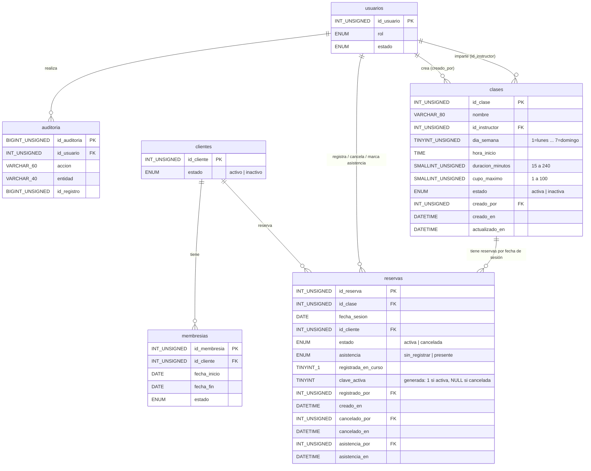

# Modelo de datos (Fase 1): Reservas de clases grupales

**Feature**: [spec.md](./spec.md) | **Investigación**: [research.md](./research.md)

**Migración nueva**: `database/migrations/006_create_clases_reservas.sql`. Sigue a
`005_indices_dashboard.sql`; no modifica ninguna migración anterior (principio IV).

Convenciones (iguales a las migraciones 001 a 005):
- Motor InnoDB, `DEFAULT CHARSET=utf8mb4 COLLATE=utf8mb4_unicode_ci`.
- Llaves foráneas con `ON DELETE RESTRICT ON UPDATE RESTRICT`.
- Nombres de tablas y columnas en español, en minúsculas y con guion bajo.
- Las restricciones CHECK y las columnas generadas `STORED` funcionan en MySQL 8.0.16+ y MariaDB
  10.4+ (el proyecto ya las usa en `rostros` y `accesos`).

## Diagrama entidad-relación



La **Sesión** no es una tabla: se identifica por `(id_clase, fecha_sesion)` y se calcula al
consultar (research R-01).

---

## Entidad: Clase (`clases`) — tabla nueva

Actividad grupal que se repite cada semana.

| Campo | Tipo MySQL | Nulo | Restricciones / valor por omisión | FR |
|-------|------------|------|-----------------------------------|----|
| `id_clase` | `INT UNSIGNED` | NO | `AUTO_INCREMENT`, **PK** | FR-001 |
| `nombre` | `VARCHAR(80)` | NO | `CHECK (CHAR_LENGTH(TRIM(nombre)) > 0)` | FR-001 |
| `id_instructor` | `INT UNSIGNED` | NO | **FK** → `usuarios(id_usuario)`; el servicio exige rol `entrenador` y estado `activo` | FR-001 |
| `dia_semana` | `TINYINT UNSIGNED` | NO | `CHECK (dia_semana BETWEEN 1 AND 7)`; ISO 8601: 1 = lunes, 7 = domingo | FR-001, FR-002 |
| `hora_inicio` | `TIME` | NO | `CHECK (hora_inicio >= '00:00:00' AND hora_inicio < '24:00:00')` | FR-001, FR-002 |
| `duracion_minutos` | `SMALLINT UNSIGNED` | NO | `CHECK (duracion_minutos BETWEEN 15 AND 240)` | FR-001 |
| `cupo_maximo` | `SMALLINT UNSIGNED` | NO | `CHECK (cupo_maximo BETWEEN 1 AND 100)` | FR-001, FR-004 |
| `estado` | `ENUM('activa', 'inactiva')` | NO | `DEFAULT 'activa'` | FR-001, FR-010 |
| `creado_por` | `INT UNSIGNED` | NO | **FK** → `usuarios(id_usuario)` | FR-012 |
| `creado_en` | `DATETIME` | NO | `DEFAULT CURRENT_TIMESTAMP` | FR-012 |
| `actualizado_en` | `DATETIME` | NO | `DEFAULT CURRENT_TIMESTAMP ON UPDATE CURRENT_TIMESTAMP` | — |

Restricción adicional:
- `chk_clases_mismo_dia`: `CHECK (TIME_TO_SEC(hora_inicio) + duracion_minutos * 60 <= 86400)`.
  La clase termina el mismo día (research R-06).

Índices:
- `PRIMARY KEY (id_clase)`
- `KEY idx_clases_dia_estado (dia_semana, estado, hora_inicio)`: genera el horario semanal (FR-002,
  FR-008).
- `KEY idx_clases_instructor_dia (id_instructor, dia_semana, estado)`: empalme del instructor (US1,
  criterio 5).
- `KEY idx_clases_creado_por (creado_por)`: índice de la llave foránea.

Sin `UNIQUE` sobre `nombre`: puede haber "Spinning" el lunes y el miércoles.

**Reglas que valida el servicio** (no las puede expresar la base):
- El instructor existe, está activo y tiene rol `entrenador` (US1, criterio 6).
- No hay otra clase activa del mismo instructor y el mismo día cuyo horario se empalme (US1,
  criterio 5; research R-03).
- No se reduce `cupo_maximo` por debajo del mayor número de reservas activas de una sesión futura
  (US1, criterio 9; FR-010).
- No se cambian `dia_semana`, `hora_inicio` ni `duracion_minutos`, ni se pasa a `inactiva`, si hay
  reservas activas en sesiones futuras (US1, criterios 10 y 11; FR-010).
- Solo el administrador escribe (FR-011).

**Transiciones de estado**:

```text
activa ──(desactivar, sin reservas activas futuras)──▶ inactiva
```

La reactivación no forma parte del alcance (FR-001 solo pide desactivar).

"Sesión futura" significa una sesión con `fecha_sesion > hoy`, o con `fecha_sesion = hoy` que
todavía no termina, en la zona horaria del gimnasio (research R-05).

---

## Entidad: Sesión — calculada, sin tabla

| Atributo | Origen | FR |
|----------|--------|----|
| `id_clase` | `clases.id_clase` | FR-002 |
| `fecha_sesion` | Fecha de la ventana `[hoy, hoy + 7]` cuyo día ISO coincide con `clases.dia_semana` | FR-002, FR-006 |
| `hora_inicio`, `hora_fin` | `clases.hora_inicio` y `hora_inicio + duracion_minutos` | FR-002 |
| `reservas_activas` | `COUNT(*)` de `reservas` con `estado = 'activa'` de esa clase y fecha | FR-008 |
| `lugares_disponibles` | `cupo_maximo − reservas_activas` (nunca negativo, por FR-004) | FR-004, FR-008 |
| `llena` | `lugares_disponibles = 0` | FR-008 (US4, criterio 5) |
| `estado_sesion` | `pendiente`, `en_curso` o `terminada`, según `nowInGym()` (research R-05) | FR-006, FR-009, FR-014 |

Una fecha de sesión es válida para una clase solo si el día de la semana coincide. Si no coincide,
el servidor responde `400 VALIDATION_ERROR`.

---

## Entidad: Reserva (`reservas`) — tabla nueva

Lugar apartado para un cliente en una sesión.

| Campo | Tipo MySQL | Nulo | Restricciones / valor por omisión | FR |
|-------|------------|------|-----------------------------------|----|
| `id_reserva` | `INT UNSIGNED` | NO | `AUTO_INCREMENT`, **PK** | FR-003 |
| `id_clase` | `INT UNSIGNED` | NO | **FK** → `clases(id_clase)` | FR-002, FR-003 |
| `fecha_sesion` | `DATE` | NO | El servicio valida que coincida con `dia_semana` y esté en la ventana | FR-002, FR-006 |
| `id_cliente` | `INT UNSIGNED` | NO | **FK** → `clientes(id_cliente)` | FR-003 |
| `estado` | `ENUM('activa', 'cancelada')` | NO | `DEFAULT 'activa'` | FR-007 |
| `asistencia` | `ENUM('sin_registrar', 'presente')` | NO | `DEFAULT 'sin_registrar'`. "No asistió" se calcula: reserva activa, `sin_registrar` y sesión de un día anterior (US5, criterio 6) | FR-009 |
| `registrada_en_curso` | `TINYINT(1)` | NO | `DEFAULT 0`; `CHECK (registrada_en_curso IN (0, 1))`. Vale 1 si se registró con la sesión en curso | FR-006 |
| `clave_activa` | `TINYINT UNSIGNED` | SÍ | Columna generada `AS (IF(estado = 'activa', 1, NULL)) STORED`; participa en el índice único | FR-005 |
| `registrado_por` | `INT UNSIGNED` | NO | **FK** → `usuarios(id_usuario)` | FR-012 |
| `creado_en` | `DATETIME` | NO | `DEFAULT CURRENT_TIMESTAMP` | FR-012 |
| `cancelado_por` | `INT UNSIGNED` | SÍ | **FK** → `usuarios(id_usuario)` | FR-007, FR-012 |
| `cancelado_en` | `DATETIME` | SÍ | — | FR-007, FR-012 |
| `asistencia_por` | `INT UNSIGNED` | SÍ | **FK** → `usuarios(id_usuario)` | FR-009 |
| `asistencia_en` | `DATETIME` | SÍ | — | FR-009 |

Restricciones CHECK:
- `chk_reservas_cancelacion`: `(estado = 'activa' AND cancelado_por IS NULL AND cancelado_en IS
  NULL) OR (estado = 'cancelada' AND cancelado_por IS NOT NULL AND cancelado_en IS NOT NULL)`
  (FR-007).
- `chk_reservas_asistencia`: `(asistencia = 'sin_registrar' AND asistencia_por IS NULL AND
  asistencia_en IS NULL) OR (asistencia = 'presente' AND asistencia_por IS NOT NULL AND
  asistencia_en IS NOT NULL)` (FR-009).
- `chk_reservas_cancelada_sin_asistencia`: `NOT (estado = 'cancelada' AND asistencia =
  'presente')`. Una reserva con asistencia no se puede cancelar, porque su sesión ya empezó (US3,
  criterio 2).

No se agrega un CHECK que obligue a `asistencia = 'presente'` cuando `registrada_en_curso = 1`:
la asistencia de una reserva hecha durante la clase se puede desmarcar después (US5, criterio 5).
Esa regla se valida solo al crear la reserva.

Índices:
- `PRIMARY KEY (id_reserva)`
- `UNIQUE KEY uq_reservas_sesion_cliente_activa (id_clase, fecha_sesion, id_cliente,
  clave_activa)`. Impide dos reservas activas del mismo cliente en la misma sesión; las canceladas
  (`clave_activa = NULL`) no cuentan, así que el cliente puede volver a reservar (US2, criterio 5;
  US3, criterio 4; FR-005). Su prefijo `(id_clase, fecha_sesion)` también sirve para contar las
  reservas activas de una sesión (FR-004, FR-008).
- `KEY idx_reservas_cliente_fecha (id_cliente, fecha_sesion, estado)`: empalme del cliente (US2,
  criterio 6; FR-005).
- `KEY idx_reservas_clase_fecha_estado (id_clase, fecha_sesion, estado)`: conteo de activas por
  sesión y búsqueda de sesiones futuras con reservas al modificar o desactivar una clase (FR-010).
- Índices de las llaves foráneas `registrado_por`, `cancelado_por` y `asistencia_por` (InnoDB los
  crea automáticamente si no existen).

**Reglas que valida el servicio** (dentro de la transacción con bloqueos cliente → clase, research
R-02):

| Regla | Mensaje | HTTP | Criterio / FR |
|-------|---------|------|---------------|
| La clase existe | "La clase no existe." | 404 | — |
| La clase está activa | "La clase está inactiva." | 422 | US1-12 |
| La fecha coincide con el día de la clase | Error de validación del campo `fecha_sesion` | 400 | FR-002 |
| La sesión no ha terminado y la fecha está en `[hoy, hoy + 7]` | "Solo se puede reservar en clases que no han terminado y dentro de los próximos 7 días." | 422 | US2-7, FR-006 |
| El cliente existe y está activo | "Cliente no encontrado o inactivo." | 422 | US2-4 |
| Membresía vigente en `fecha_sesion` (research R-07) | "El cliente no tiene una membresía vigente para la fecha de la clase." | 422 | US2-3, FR-003 |
| Sin reserva activa del cliente en la sesión | "El cliente ya tiene una reserva en esta clase." | 409 | US2-5, FR-005 |
| Sin reserva activa del cliente que se empalme ese día | "El cliente ya tiene una reserva en una clase que se empalma con este horario." | 422 | US2-6, FR-005 |
| `reservas_activas < cupo_maximo` | "Clase llena." | 422 | US2-2, US2-9, FR-004 |
| Si la sesión está en curso: `asistencia = 'presente'` y `registrada_en_curso = 1` | — | 201 | US2-8, FR-006 |

**Transiciones de estado**:

```text
                    ┌───────────── cancelar (sesión pendiente) ─────────────┐
                    ▼                                                       │
  [crear] ──▶ activa / sin_registrar ──(marcar, sesión iniciada hoy)──▶ activa / presente
                    ▲                                                       │
                    └──────────(desmarcar, mismo día de la sesión)──────────┘
  activa / sin_registrar ──(cancelar, sesión pendiente)──▶ cancelada / sin_registrar  (final)
  [crear en curso] ──▶ activa / presente (registrada_en_curso = 1)
```

- **Cancelar** (US3): solo `activa` → `cancelada` y solo si la sesión está `pendiente`. Si la
  sesión ya empezó: "No se puede cancelar una reserva de una clase que ya empezó." (422). Si ya
  estaba cancelada: "La reserva ya está cancelada." (422).
- **Marcar o desmarcar asistencia** (US5): solo en reservas `activa`, con `fecha_sesion = hoy` y la
  hora actual ≥ `hora_inicio`. Antes del inicio: "La asistencia solo se puede registrar a partir de
  la hora de inicio de la clase." Después del día de la sesión: "La asistencia solo se puede
  registrar el mismo día de la clase." En una reserva cancelada: "El cliente no tiene una reserva
  activa en esta clase."
- Las reservas nunca se borran; las canceladas se conservan en el historial (FR-007).

---

## Entidades existentes que se reutilizan (sin cambios de estructura)

| Entidad | Uso en esta feature | FR |
|---------|---------------------|----|
| `usuarios` | Instructor (rol `entrenador`, activo) y autor de las acciones | FR-001, FR-011, FR-012 |
| `clientes` | Cliente que reserva; debe estar `activo`; su fila se bloquea al reservar | FR-003, FR-005 |
| `membresias` | Vigencia en la fecha de la sesión (`findCurrentByClient`) | FR-003 |
| `auditoria` | Nuevas acciones (ver abajo) | FR-012 |

**Nuevas acciones de auditoría** (`AUDIT_ACTIONS` en `audit.service.js`):

| Acción | Entidad | `id_registro` | Descripción (sin datos sensibles) |
|--------|---------|---------------|-----------------------------------|
| `clase.crear` | `clases` | `id_clase` | `Spinning, lunes 07:00, 45 min, cupo 20` |
| `clase.modificar` | `clases` | `id_clase` | Campos cambiados, con el valor anterior y el nuevo |
| `clase.desactivar` | `clases` | `id_clase` | Nombre y horario |
| `reserva.registrar` | `reservas` | `id_reserva` | Clase, fecha de la sesión, id del cliente y si fue en curso |
| `reserva.cancelar` | `reservas` | `id_reserva` | Clase, fecha de la sesión e id del cliente |

La asistencia no se audita en `auditoria`: queda en `asistencia_por` y `asistencia_en` de la
reserva (FR-012 solo exige auditar clases, reservas y cancelaciones).

---

## Trazabilidad FR → modelo

| FR | Dónde se atiende |
|----|------------------|
| FR-001 | `clases` (campos y CHECK), validación del instructor en el servicio |
| FR-002 | `clases.dia_semana` y `hora_inicio`; sesiones calculadas (R-01); `reservas.fecha_sesion` |
| FR-003 | `reservas.id_cliente`; validaciones de cliente y membresía |
| FR-004 | Bloqueo `FOR UPDATE` de la clase + conteo (R-02); `cupo_maximo` |
| FR-005 | `uq_reservas_sesion_cliente_activa`; `idx_reservas_cliente_fecha` + empalme (R-03) |
| FR-006 | Ventana `[hoy, hoy + 7]`, estado de la sesión, `registrada_en_curso` |
| FR-007 | `reservas.estado`, `cancelado_por`, `cancelado_en`; `chk_reservas_cancelacion` |
| FR-008 | Conteo por `(id_clase, fecha_sesion)`; sesión calculada con `lugares_disponibles` |
| FR-009 | `reservas.asistencia`, `asistencia_por`, `asistencia_en`; `chk_reservas_asistencia` |
| FR-010 | `idx_reservas_clase_fecha_estado` para detectar reservas futuras al modificar o desactivar |
| FR-011 | Middleware `authorize` (sin cambios de modelo) |
| FR-012 | `auditoria` con las nuevas acciones; columnas `*_por` y `*_en` |
| FR-013 | Mensajes de la tabla de reglas (research R-08) |
| FR-014 | `nowInGym()` con `APP_TIMEZONE` (research R-05); sin `NOW()` en SQL |
